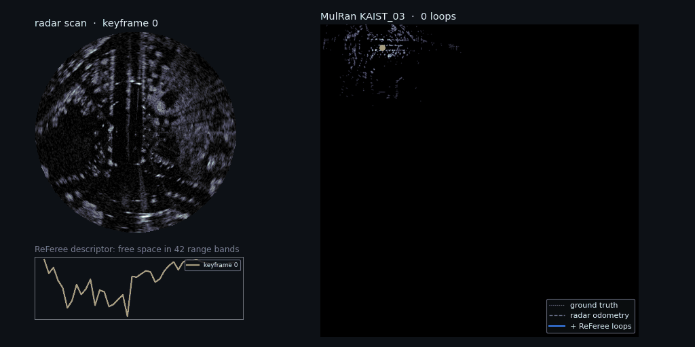

<div align="center">
  <h1>ReFeree</h1>
  <a href="https://github.com/sparolab/ReFeree/tree/main/cpp"></a>
  <a href="https://github.com/sparolab/ReFeree/tree/main/python"></a>
  <a href="https://pypi.org/project/referee-radar/"></a>
  <a href="https://github.com/sparolab/ReFeree/tree/main/applications/slam/ros1"></a>
  <a href="https://github.com/sparolab/ReFeree/tree/main/applications/slam/ros2"></a>
  <a href="#docker"></a>
  <a href="#docker"></a>
  <br />
  <a href="https://sites.google.com/view/referee-radar"></a>
  <a href="https://ieeexplore.ieee.org/document/10705066"></a>
  <a href="https://arxiv.org/abs/2410.01325"></a>
  <a href="https://www.youtube.com/watch?v=aQ0OlHYJCYI"></a>
  <a href="#robot-run-with-your-agent"></a>
  <a href="#robot-run-with-your-agent"></a>
  <a href="https://github.com/sparolab/ReFeree/actions/workflows/ci.yml"></a>
  <br />
  <a href="https://pypi.org/project/referee-radar/"></a>
  <br />
  
  <p>
    <strong>[IEEE RA-L 2024] ReFeree: Radar-Based Lightweight and Robust Localization<br />
    Using Feature and Free Space</strong>
  </p>
</div>

______________________________________________________________________

Radar clutter adds false detections but rarely clears space that is occupied, so ReFeree describes a place by its free space and its features together:

- :ring: **Rotation invariant and tiny**: the range descriptor counts free space per range band, averaged over azimuth; a few dozen floats per place.
- :compass: **Yaw for free**: the angle descriptor (free space per sector) gives the heading between two matched scans by a circular shift.
- :feather: **Lightweight**: a brute-force cosine search is faster than a tree at this size, in C++ and in Python (same descriptors, checked in CI).
- :repeat: **Online loop closing**: radar odometry + ReFeree loops verified by nano-GICP in an iSAM2 pose graph, on ROS 1 and ROS 2.
- :world_map: **Multi-session SLAM**: sessions from different runs are aligned into one map ([guide](applications/multi-session-slam)).
- :busts_in_silhouette: **Multi-robot**: map merging from a few exchanged keyframes ([Commerge](https://github.com/sparolab/Commerge)).

## :floppy_disk: Datasets

The examples use **[MulRan](https://sites.google.com/view/mulran-pr)** `KAIST_03` (Navtech CIR204 radar, polar scans and `xypose.csv` ground truth). The odometry reads scans in the Oxford layout; convert MulRan once:

```bash
python applications/slam/tools/mulran_to_oxford.py <MulRan>/KAIST_03/polar <out>/KAIST_03/polar   # Oxford layout
```

`dataset:=mulran` (0.0596 m per range bin, also Boreas, the default) or `dataset:=oxford` (0.0432 m, Oxford Radar RobotCar) sets the range resolution; a wrong value scales the whole trajectory.

______________________________________________________________________

## :package: Installation

```bash
pip install referee-radar                            # the library (import referee; NumPy, SciPy, OpenCV)
```

### Docker

```bash
docker build -f docker/ros2/Dockerfile -t referee:humble .      # ROS 2 Humble: core, SLAM, multi-session, checks
docker build -f docker/ros1/Dockerfile -t referee:noetic .      # ROS 1 Noetic: the same
docker run --rm referee:humble bash /referee/docker/validate.sh # C++ tests, Python tests, C++/Python parity
```

See [docker/README.md](docker/README.md).

### From source

<details open>
<summary><strong>C++ library</strong></summary>

```bash
sudo apt install libopencv-dev libeigen3-dev        # macOS: brew install opencv eigen libomp
cmake -S cpp -B cpp/build -DCMAKE_BUILD_TYPE=Release && cmake --build cpp/build -j8
ctest --test-dir cpp/build                          # the published descriptors, retrieval and yaw
```

In your project, `add_subdirectory(ReFeree/cpp)` and link `referee::referee`.

</details>

<details open>
<summary><strong>ROS 1 Noetic / ROS 2 Humble</strong></summary>

PCL and GTSAM, then [applications/slam](applications/slam): `catkin config --source-space applications/slam/ros1 && catkin build` (ROS 1) or `colcon build --base-paths applications/slam/ros2 applications/multi-session-slam` (ROS 2). Both build the same ROS-free odometry and back end from [applications/slam/common](applications/slam/common). The Dockerfiles list every step.

</details>

______________________________________________________________________

## :rocket: Run

```bash
# ROS 2 Humble
ros2 launch referee_slam referee_slam.launch.py sequence_dir:=<out>/KAIST_03 save_directory:=$HOME/kaist03/ dataset:=mulran
# ROS 1 Noetic
roslaunch referee_radar_slam referee_radar_slam.launch seq_dir:=<out>/KAIST_03/ save_directory:=$HOME/kaist03/ dataset:=mulran
# Docker
docker run --rm -v <out>/KAIST_03:/data/KAIST_03:ro -v $HOME/kaist03:/data/output referee:humble \
    ros2 launch referee_slam referee_slam.launch.py sequence_dir:=/data/KAIST_03 save_directory:=/data/output/ dataset:=mulran
```

Radar odometry (Yeti: Cen features, ORB matching, motion-distorted RANSAC) gives the motion, the feature cloud and the ReFeree descriptors of every scan; the pose-graph node finds loops with the range descriptor, verifies them by nano-GICP seeded with the angle descriptor's yaw (fitness ≤ 200, residual translation ≤ 3 m), and optimizes with iSAM2 and a Cauchy kernel. The run is saved as a **session** (`optimized_poses_kitti.txt`, `odom_poses_kitti.txt`, `keyframe_times.txt`, the `.g2o` graph, descriptors and scans).

On MulRan `KAIST_03` (6.25 km), ReFeree loops bring the radar odometry from 71.7 m to **5.5 m** mean error, the same on ROS 1 and ROS 2. Results and the trajectory figure: [applications/slam](applications/slam#results).

Without ROS:

```python
import referee

def describe(path):
    scan = referee.load_polar_scan(path, referee.NavtechModel.CIR204)       # MulRan; CTS350 for Oxford
    polar = referee.targets_to_polar_image(scan.power.shape, referee.cen2018_features(scan.power))
    return referee.make_range_descriptor(polar), referee.make_angle_descriptor(polar)

places, yaws = referee.RangeDescriptorDatabase(), referee.AngleDescriptorDatabase()
for path in map_scans:
    r, a = describe(path)
    places.add(r), yaws.add(a)

r, a = describe(query_scan)
match = places.detect_loop_closure(r)
if match:
    print(match.index, match.similarity, yaws.yaw_difference(a, match.index))   # place, cosine, yaw (rad)
```

The same in C++: `referee::makeRangeDescriptor`, `referee::RangeDescriptorDatabase::detectLoopClosure`, `referee::AngleDescriptorDatabase::yawDifference` ([cpp/include/referee](cpp/include/referee)).

______________________________________________________________________

## :toolbox: Tools

### Multi-session SLAM

LT-SLAM style ([LT-mapper](https://github.com/gisbi-kim/lt-mapper)), as in [RadLoc](https://github.com/sparolab/RadLoc) and [Sonar Context](https://github.com/sparolab/sonar_context): each session keeps its own frame and gets an anchor node; inter-session ReFeree loops, verified by the same nano-GICP check as the single-session back end, connect the sessions through their anchors. `KAIST_03` cut in two halves, each in its own frame: the second half lands within **0.65 m** (median) of the first. Results: [applications/multi-session-slam](applications/multi-session-slam#results).

```bash
multi_session_node applications/multi-session-slam/config/kaist03_split.yaml     # sessions_dir/{01,02} -> save_directory
```

See the [multi-session SLAM guide](applications/multi-session-slam).

### Multi-Robot Map Merging

Each robot keeps its place descriptors; [Commerge](https://github.com/sparolab/Commerge) (IJRR 2026) picks the few keyframes that carry the overlap, and only those are exchanged. Its radar demo splits MulRan `KAIST_03` into two robots (robot B in a frame turned by 60°) with a radar band descriptor; ReFeree's range descriptor plugs into the same affinity.

<p align="center"><a href="https://github.com/sparolab/Commerge"></a></p>

See [applications/multi-robot-slam](applications/multi-robot-slam).

______________________________________________________________________

## :robot: Run with your agent

Open [Claude Code](https://claude.com/claude-code) or [Codex](https://openai.com/codex/) in an empty folder and paste:

```text
Clone https://github.com/sparolab/ReFeree, read its AGENTS.md, and follow it to build ReFeree and run its SLAM on MulRan KAIST_03 on this machine. Ask me what you need along the way.
```

The agent follows [`AGENTS.md`](AGENTS.md): it installs the library, builds the Docker image, converts the scans, runs the SLAM and checks the result.

______________________________________________________________________

## :wrench: What changed in v2

- **One repository, library first** (November 2026): the C++ core and the Python package (`pip install referee-radar`) give the same descriptors; [ReFeree-Radar-SLAM](https://github.com/sparolab/ReFeree-Radar-SLAM) (ROS 1, September 2024) is merged in, next to ROS 2, both on one ROS-free back end.
- **The published descriptors, kept**: both reproduce the code released with the paper (checked in CI). Its two off-by-one errors stay on by default and can be switched off: `legacy_window_alignment` (the range window starts one bin late) and `legacy_skip_nearest_bin` (the angle scan never examines bin 0); see [python/README.md](python/README.md).
- **MulRan range resolution**: the released odometry assumed Oxford's 0.0432 m per bin; MulRan's radar is 0.0596 m, so trajectories came out 1.38 times too small. `dataset:=mulran|oxford` sets it.
- **Odometry RANSAC**: motion-distorted RANSAC drew a fixed 100 pairs and took the best even when 2 matches supported it (a 32 m, 33° jump on `KAIST_03`); it now draws adaptively to 99.9 % confidence, and a motion supported by fewer than 10 matches keeps the previous one.
- **Loop verification**: nano-GICP seeded with the descriptor yaw, fitness ≤ 200, and the residual translation ≤ 3 m; the seed rotation is now part of the constraint.

______________________________________________________________________

## Citation

If you use ReFeree in your research, please cite our [paper](https://ieeexplore.ieee.org/document/10705066).

<details>
  <summary><strong>See bibtex</strong></summary>

```bibtex
@article{kim2024referee,
  title={ReFeree: Radar-Based Lightweight and Robust Localization using Feature and Free space},
  author={Kim, Hogyun and Choi, Byunghee and Choi, Euncheol and Cho, Younggun},
  journal={IEEE Robotics and Automation Letters},
  year={2024},
  publisher={IEEE}
}
```

</details>

## Contributing

Issues and pull requests are welcome.

<a href="https://github.com/sparolab/ReFeree/graphs/contributors">
  
</a>

## Acknowledgements

The radar odometry is [Yeti](https://github.com/keenan-burnett/yeti_radar_odometry) by Keenan Burnett (BSD-3-Clause), with the feature detector of Sarah H. Cen and Paul Newman. Loops are verified with [nano-GICP](https://github.com/engcang/nano_gicp) (MIT); the SLAM structure follows [Navtech-Radar-SLAM](https://github.com/gisbi-kim/navtech-radar-slam). Related: [RadLoc](https://github.com/sparolab/RadLoc), [SOLiD](https://github.com/sparolab/SOLiD), [Commerge](https://github.com/sparolab/Commerge), [SKiD-SLAM](https://github.com/sparolab/SKiD-SLAM).

## Special Thanks

We sincerely thank **[Sarah H. Cen](https://scholar.google.com/citations?user=2BTuWpgAAAAJ&hl=en)** for the radar feature extraction ReFeree builds on, **[Keenan Burnett](https://github.com/keenan-burnett)** for [Yeti radar odometry](https://github.com/keenan-burnett/yeti_radar_odometry) and the [radar-to-LiDAR calibration](https://github.com/keenan-burnett/radar_to_lidar_calib), and **[Giseop Kim](https://gisbi-kim.github.io/)** for open-sourcing [LT-mapper](https://github.com/gisbi-kim/lt-mapper), whose multi-session design and `BetweenFactorWithAnchoring` (MIT License) our multi-session SLAM follows.

## License

BSD 3-Clause for academic use; for any commercial purpose, please contact the authors. See [LICENSE](LICENSE). Vendored code keeps its own license (Yeti: BSD-3-Clause, nano-GICP: MIT, LT-mapper's anchoring factor: MIT).
