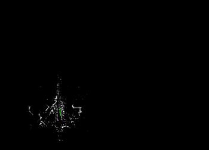
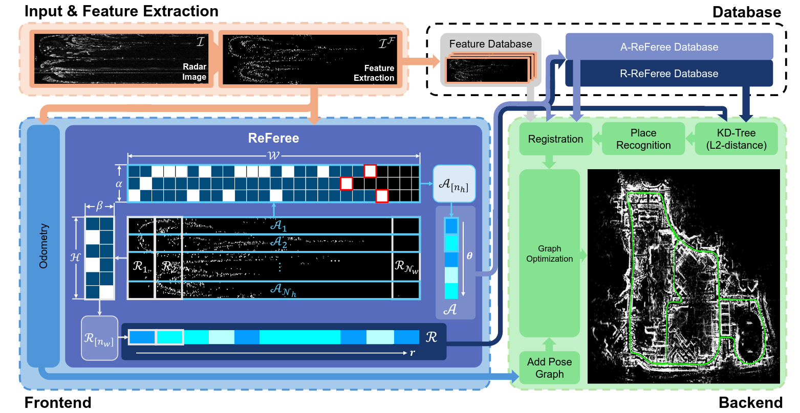
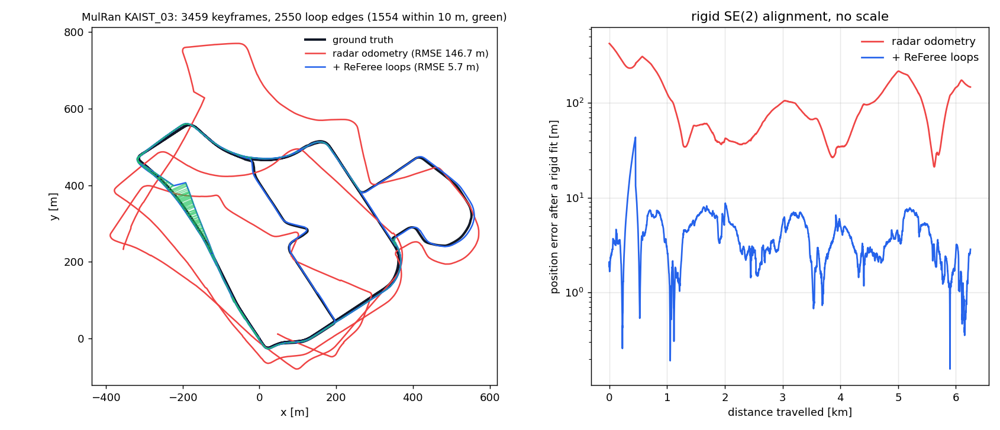

<div align="center">
  <h1>ReFeree</h1>
  <a href="https://github.com/sparolab/ReFeree/tree/main/python/referee"></a>
  <a href="https://pypi.org/project/referee-radar/"></a>
  <a href="https://github.com/sparolab/ReFeree/tree/main/cpp"></a>
  <a href="#ros-1-noetic"></a>
  <a href="#ros-2-humble"></a>
  <a href="#docker"></a>
  <a href="https://github.com/sparolab/ReFeree/actions/workflows/ci.yml"></a>
  <a href="https://sites.google.com/view/referee-radar"></a>
  <a href="https://arxiv.org/abs/2410.01325"></a>
  <a href="https://ieeexplore.ieee.org/document/10705066"></a>
  <a href="https://www.youtube.com/watch?v=aQ0OlHYJCYI"></a>
  <br />
  <a href="https://pypi.org/project/referee-radar/"></a>
  <br />
  <!-- hero GIF: assets/referee_demo.gif (to come); until then the SLAM GIF -->
  
  <p>
    <strong>[IEEE RA-L 2024] ReFeree: Radar-Based Lightweight and Robust Localization<br />
    Using Feature and Free Space</strong>
  </p>

  <a href="https://scholar.google.com/citations?user=t5UEbooAAAAJ&hl=ko" target="_blank">Hogyun Kim*</a>,
  <a href="https://scholar.google.com/citations?user=JCJAwgIAAAAJ&hl=ko" target="_blank">Byunghee Choi*</a>,
  <a href="https://scholar.google.co.kr/citations?view_op=list_works&hl=ko&user=rcp7sWAAAAAJ" target="_blank">Euncheol Choi</a>,
  <a href="https://scholar.google.com/citations?user=W5MOKWIAAAAJ&hl=ko" target="_blank">Younggun Cho</a><sup>†</sup>
  <br />
  (* equal contribution) &nbsp; <a href="https://sites.google.com/view/sparo">Spatial AI and Robotics Lab (SPARO)</a>, Inha University
</div>

______________________________________________________________________

A radar scan's free space and its detections carry opposite noise: clutter adds false detections, but it rarely clears space that is occupied. ReFeree describes a place by both:

- :ring: **Range descriptor**: free space counted per range band, averaged over azimuth. One dimension, **rotation invariant**, a few dozen floats per place.
- :compass: **Angle descriptor**: free space per angular sector. Once a place matches, its circular shift gives the **yaw** between the two scans, with no correspondences and no initial guess.
- :feather: **Lightweight**: brute-force cosine search over the range descriptors is faster than a tree at this size.
- :repeat: **SLAM on ROS 1 and ROS 2**: radar odometry, ReFeree loop closing with ICP verification, and an iSAM2 pose graph.

<p align="center"></p>

## :newspaper: News

- [November, 2026] **v2.0.0**: one library-first repository. The C++ core and the Python package (`pip install referee-radar`) give the same descriptors; ReFeree-Radar-SLAM (ROS 1) is merged in under `applications/slam/ros1`, next to a new ROS 2 port.
- [September, 2024] The C++ version of ReFeree is released.
- [September, 2024] [ReFeree-Radar-SLAM](https://github.com/sparolab/ReFeree-Radar-SLAM) is released (now part of this repository).
- [September, 2024] The Python version of ReFeree is released.
- [September, 2024] ReFeree is accepted in RA-L.

______________________________________________________________________

## :package: Prerequisites

- **Library**: Python 3.9+ (NumPy, SciPy, OpenCV), or C++17 with OpenCV and Eigen. Ubuntu and macOS.
- **SLAM**: ROS 1 Noetic (Ubuntu 20.04) or ROS 2 Humble (Ubuntu 22.04), with GTSAM and PCL; or just Docker.
- **Data**: Navtech polar scans in the Oxford layout (one row per azimuth: 8-byte timestamp, 2-byte encoder, 1-byte valid flag, then the range bins), as `<sequence>/polar/<timestamp>.png`. [MulRan](https://sites.google.com/view/mulran-pr), [Oxford Radar RobotCar](https://oxford-robotics-institute.github.io/radar-robotcar-dataset/) and [Boreas](https://www.boreas.utias.utoronto.ca/) work.

## :hammer_and_wrench: Installation

```bash
pip install referee-radar                 # the Python package (import referee)
# or from a clone:
git clone https://github.com/sparolab/ReFeree.git && cd ReFeree && pip install .
```

C++ core (`referee::referee`, ROS-free):

```bash
sudo apt install libopencv-dev libeigen3-dev       # macOS: brew install opencv eigen
cmake -S cpp -B cpp/build && cmake --build cpp/build -j && ctest --test-dir cpp/build
```

```cmake
add_subdirectory(ReFeree/cpp)                      # or install it and find_package(referee)
target_link_libraries(my_target referee::referee)
```

## :rocket: Quick start

```python
import referee

def describe(path):
    scan = referee.load_polar_scan(path, referee.NavtechModel.CIR204)       # MulRan; CTS350 for Oxford
    polar = referee.targets_to_polar_image(scan.power.shape, referee.cen2018_features(scan.power))
    return referee.make_range_descriptor(polar), referee.make_angle_descriptor(polar)

places, yaws = referee.RangeDescriptorDatabase(), referee.AngleDescriptorDatabase()
for path in map_scans:
    r, a = describe(path)
    places.add(r), yaws.add(a)

r, a = describe(query_scan)
match = places.detect_loop_closure(r)
if match:
    print(match.index, match.similarity, yaws.yaw_difference(a, match.index))   # place, cosine, yaw (rad)
```

The same in C++: `referee::makeRangeDescriptor`, `referee::RangeDescriptorDatabase::detectLoopClosure`, `referee::AngleDescriptorDatabase::yawDifference` ([cpp/include/referee](cpp/include/referee)). Both reproduce the descriptors of the code released with the paper (checked in CI); the two off-by-one errors of that code are kept by default and can be switched off, see [python/README.md](python/README.md).

______________________________________________________________________

## :world_map: SLAM

```
applications/slam/
├── ros1/   referee_radar_slam: Yeti radar odometry + ReFeree loops + ICP + iSAM2 (the former ReFeree-Radar-SLAM)
└── ros2/   referee_odometry + referee_slam: the same pipeline on ROS 2, GTSAM 4.2
```

Both read a sequence folder (`<sequence>/polar/*.png`) and write the keyframe poses (odometry and optimized, KITTI format) and the pose graph.

On MulRan `KAIST_03` (ROS 2): 3,395 keyframes and 2,171 loops. Odometry alone drifts to 98.3 m; with ReFeree closing loops the error stays near 6 m over the whole 6.2 km route.

<p align="center"></p>

### ROS 1 (Noetic)

```bash
cd ~/catkin_ws/src && ln -s /path/to/ReFeree/applications/slam/ros1 referee
cd .. && catkin build nano_gicp && catkin build
roslaunch referee_radar_slam referee_radar_slam.launch seq_dir:=/data/KAIST_03/ save_directory:=/data/output/ rviz:=true
```

### ROS 2 (Humble)

```bash
cd ~/ros2_ws && colcon build --base-paths /path/to/ReFeree/applications/slam/ros2
ros2 launch referee_slam referee_slam.launch.py sequence_dir:=/data/KAIST_03 save_directory:=/data/output/
```

### Docker

```bash
docker build -f docker/ros1/Dockerfile -t referee:noetic .
docker build -f docker/ros2/Dockerfile -t referee:humble .
docker run --rm -v /data/MulRan/KAIST_03:/data/KAIST_03:ro -v $PWD/output:/data/output referee:humble \
    ros2 launch referee_slam referee_slam.launch.py sequence_dir:=/data/KAIST_03 save_directory:=/data/output/
docker run --rm referee:humble bash /referee/docker/validate.sh     # every check: C++ tests, Python tests, parity
```

## :link: Multi-session

Aligning several sessions of the same place through ReFeree loops is planned: [applications/multi-session-slam](applications/multi-session-slam).

## :busts_in_silhouette: Multi-robot

Two radar robots that never met can merge their maps from a place descriptor alone with [Commerge](https://github.com/sparolab/Commerge) (IJRR 2026): it picks the few keyframes worth exchanging and fits the maps on them. Its [radar demo](https://github.com/sparolab/Commerge/tree/main/tools/demo/radar) splits MulRan into two robots. See [applications/multi-robot-slam](applications/multi-robot-slam).

______________________________________________________________________

## :books: Citation

```bibtex
@article{kim2024referee,
  title={ReFeree: Radar-Based Lightweight and Robust Localization using Feature and Free space},
  author={Kim, Hogyun and Choi, Byunghee and Choi, Euncheol and Cho, Younggun},
  journal={IEEE Robotics and Automation Letters},
  year={2024},
  publisher={IEEE}
}
```

## :pray: Special Thanks

- [Sarah H. Cen](https://scholar.google.com/citations?user=2BTuWpgAAAAJ&hl=en): the radar feature extraction ReFeree builds on.
- [Keenan Burnett](https://github.com/keenan-burnett): [radar-to-LiDAR calibration](https://github.com/keenan-burnett/radar_to_lidar_calib) and [Yeti radar odometry](https://github.com/keenan-burnett/yeti_radar_odometry), the ROS 1 odometry (BSD-3-Clause).
- [Nano-GICP](https://github.com/engcang/nano_gicp) (MIT) and [Navtech-Radar-SLAM](https://github.com/gisbi-kim/navtech-radar-slam), the structure of the ROS 1 SLAM.

## :mailbox: Contact

- Hogyun Kim (hg.kim@inha.edu)
- Byunghee Choi (bhbhchoi@inha.edu)

## :scroll: License

BSD 3-Clause for academic use; for any commercial purpose, please contact the authors. Vendored code keeps its own license (Yeti: BSD-3-Clause, nano_gicp: MIT).
