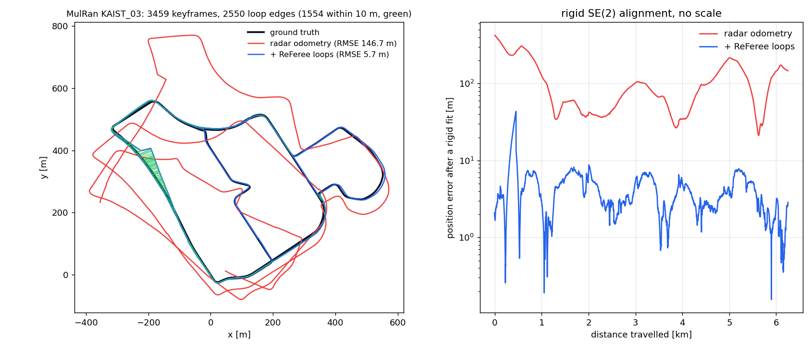

# ReFeree SLAM

ROS-free core in `common/`, thin ROS 1 (`ros1/`) and ROS 2 (`ros2/`) nodes; tools in `tools/`. Build and run: see the [main README](../../README.md#rocket-run).

## Results

MulRan `KAIST_03` (6.25 km), 3459 keyframes, 1289 loops. Position error (ATE) against MulRan's ground truth after a rigid SE(2) alignment, no scale:

| | ATE mean | RMSE | max |
| --- | --- | --- | --- |
| odometry | 71.7 m | 80.4 m | 173.7 m |
| with ReFeree loop closure | **5.5 m** | **6.2 m** | **12.7 m** |

ROS 1 and ROS 2 give the same result (ROS 1: 1306 loops, 5.5 m); 97 % of the loops are true (within 10 m in the ground truth). On 4 of the 3,460 scan pairs the odometry's feature matches agree on no motion; those scans keep the previous motion instead of taking a wrong one. Sessions and the evaluation: [applications/slam/tools](applications/slam/tools).

